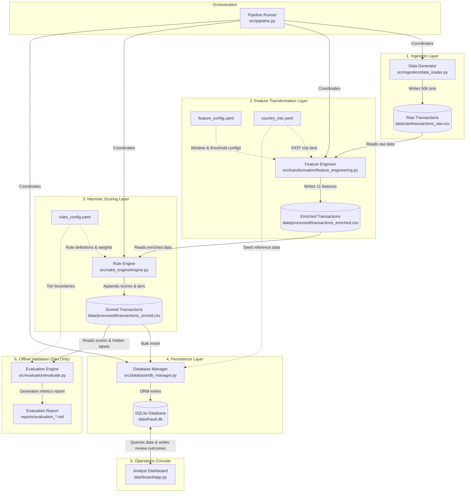
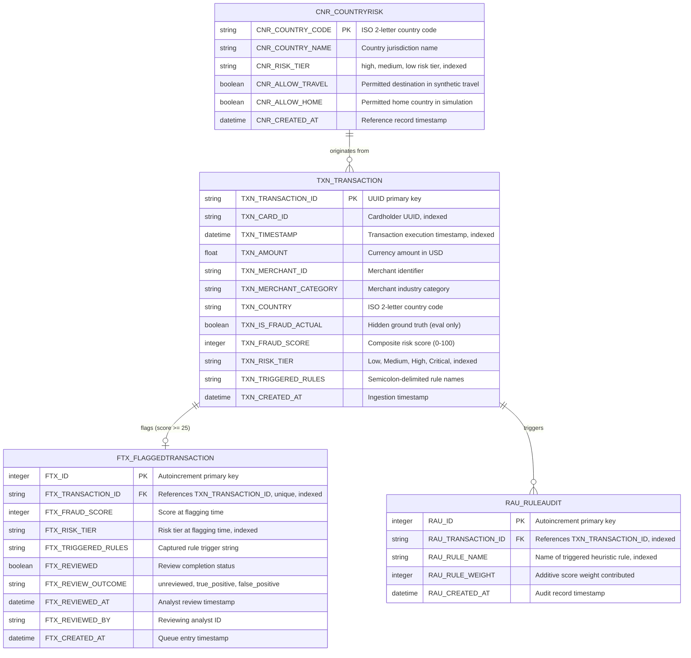

# High-Level Design (HLD): Fraud Risk Detection & Credit Risk Monitoring System

**Document Version:** 1.0.0  
**Status:** As Built  
**Target Repository:** `Fraud_Risk_Detection`  
**Reference Evaluation Date:** 2026-11-17  

---

## 1. Purpose, Users, and Scope

### 1.1 Problem Statement
Digital payment systems must continuously guard cardholders against payment fraud while keeping operational triage workloads manageable. Detecting fraudulent transactions involves a fundamental trade-off: aggressive risk thresholds capture more fraud (reducing financial loss) but increase false-positive alerts, causing cardholder friction and overwhelming fraud analysts. Conversely, loose thresholds let unauthorized transactions slip through. This project implements a deterministic, auditable, and configurable risk scoring and triage system to balance these competing requirements.

### 1.2 Target Users
The system is built for three primary user personas:
- **Fraud Operations Analysts:** Triage high-risk and critical transactions, inspect card spending histories, and record review outcomes (`true_positive` or `false_positive`) to maintain operational feedback.
- **Risk & Compliance Officers:** Monitor portfolio-level exposure ($ at risk), evaluate live false-positive rates, review jurisdictional exposure against Financial Action Task Force (FATF) country ratings, and audit triggered heuristics.
- **Risk Engineers & Data Developers:** Configure scoring rules, feature definitions, and risk tiers in external YAML configurations, run batch data pipelines, and benchmark scoring efficacy offline without corrupting operational state.

### 1.3 Scope Boundaries

#### In-Scope (What is Built)
- **Synthetic Data Generation:** Simulation of 50,000 credit card transactions across 2,000 cards over a 90-day window, incorporating realistic spending schedules, merchant distributions, legitimate international travel, and 1,400 fraud transactions across five typologies.
- **Feature Engineering Pipeline:** Extraction of 11 point-in-time behavioural, velocity, temporal, and geographic features using strictly prior-only expanding windows and a 5-transaction warmup baseline.
- **Declarative Rule Engine:** Configurable heuristic engine evaluating vectorized boolean masks for single-attribute and composite `all:` conjunction rules, outputting additive weighted fraud scores (capped at 100) and four discrete risk tiers.
- **Relational Persistence Layer:** SQLite database managed through an enterprise SQLAlchemy ORM layer using 3-letter table prefixes (`TXN_`, `FTX_`, `RAU_`, `CNR_`), compound indexes, and audit logging of triggered rules.
- **Analyst Operations Console:** Streamlit dashboard featuring multi-axis filtering, global KPI cards, time-series volume charts, country exposure breakdowns, and an in-grid review queue with direct database write-back.
- **Offline Evaluation Suite:** Validation module benchmarking scored transactions against hidden ground truth across three risk thresholds, producing confusion matrices, classification metrics, and rule attribution reports.
- **Automated Test Suite:** 76 unit and integration tests across data generation, feature engineering, rule execution, database operations, and evaluation logic.

#### Out-of-Scope (What is Not Built)
- Real-time streaming event ingestion (e.g., Apache Kafka, AWS Kinesis).
- Sub-50ms online transaction authorization scoring API (REST/gRPC).
- Automated payment gateway blocking or card suspension actions.
- Client-server enterprise RDBMS (e.g., PostgreSQL, MySQL).
- Supervised machine learning or neural network scoring models.
- Live external sanctions or currency conversion API integrations.
- User authentication, role-based access control (RBAC), or session management in the dashboard.

---

## 2. Architecture Overview

### 2.1 Architecture Diagram



### 2.2 Architectural Walkthrough
The system separates transaction generation, feature transformation, rule evaluation, persistence, operational triage, and offline benchmarking into distinct stages.

The orchestrator (`src/pipeline.py`) coordinates the sequential execution of the data pipeline. First, the data loader simulates 50,000 raw transactions and writes them to disk. The feature engineering module ingests the raw records, sorts them chronologically by card account, and generates 11 prior-only features without future data leakage. The enriched dataset is passed to the declarative rule engine, which loads rule predicates and weights from `rules_config.yaml`, evaluates vectorized boolean masks, computes additive fraud scores, and categorizes transactions into risk tiers.

Once scored, the database manager drops and recreates the SQLite schema in `data/fraud.db`, bulk-loads the transaction ledger, flags high-risk transactions, logs audit trails for all fired rules, and seeds country risk ratings. Operational fraud analysts interact with the relational store through the Streamlit console, which accesses data exclusively via `DBManager` methods (no embedded SQL). Analysts filter transactions, inspect trends, and record review determinations that write back directly to the database. Ground-truth evaluation is strictly decoupled into `src/evaluation/evaluate.py`, ensuring operational scoring and review screens never access target labels.

---

## 3. End-to-End Data Flow

### 3.1 Pipeline Data Flow Diagram

```mermaid
flowchart LR
    A["Raw Transaction Ingestion<br/>(data_loader.py)"] -->|Writes raw CSV<br/>50,000 rows| B[("transactions_raw.csv")]
    B -->|Reads raw CSV| C["Feature Engineering<br/>(feature_engineering.py)"]
    C -->|Writes enriched CSV<br/>11 derived features| D[("transactions_enriched.csv")]
    D -->|Reads enriched CSV| E["Rule Scoring Engine<br/>(engine.py)"]
    E -->|Writes scored CSV<br/>scores, tiers, rules| F[("transactions_scored.csv")]
    F -->|Reads scored CSV| G["Database Bulk Load<br/>(db_manager.py)"]
    G -->|Populates relational tables| H[("data/fraud.db<br/>TXN, FTX, RAU, CNR")]
    H <-->|Reads filtered data /<br/>Writes review outcomes| I["Streamlit Console<br/>(dashboard/app.py)"]
    F -.->|Reads scored CSV &<br/>is_fraud_actual| J["Evaluation Harness<br/>(evaluate.py)"]
    J -.->|Writes summary report| K["reports/evaluation_*.md"]
```



### 3.2 Data Contracts Across Stages

| Stage | Input Artifact / Source | Processing Applied | Output Artifact / Destination |
| :--- | :--- | :--- | :--- |
| **1. Data Ingestion** | Simulation parameters (`NUM_CARDS=2000`, `NUM_TRANSACTIONS=50000`, 90 days, seed 42). | Synthesizes baseline cardholder spending, home countries, diurnal schedules, 4% travel episodes, and 1,400 fraud events across 5 typologies. | `data/raw/transactions_raw.csv` (50,000 rows × 8 columns). |
| **2. Feature Transformation** | `transactions_raw.csv`, `feature_config.yaml`, `country_risk.yaml`. | Enforces chronological card ordering; computes prior-only rolling velocities (10m, 1h), expanding Z-scores, warmup masks, and FATF tiers. | `data/processed/transactions_enriched.csv` (50,000 rows × 19 columns). |
| **3. Rule Scoring** | `transactions_enriched.csv`, `rules_config.yaml`. | Evaluates vectorized boolean conditions for 9 enabled rules; sums weights, caps total score at 100, and assigns risk tiers. | `data/processed/transactions_scored.csv` (50,000 rows × 22 columns). |
| **4. Database Loading** | `transactions_scored.csv`, `country_risk.yaml`. | Resets `data/fraud.db`; bulk-loads master transactions (`TXN`), flags score ≥ 25 (`FTX`), logs audit trails (`RAU`), and seeds countries (`CNR`). | `data/fraud.db` (SQLite relational database file). |
| **5. Operational Review** | `data/fraud.db` accessed via `DBManager`. | Displays filterable metrics, time series, and review queue; saves analyst outcomes (`true_positive`, `false_positive`) to `FTX`. | Updated rows in `FTX_FLAGGEDTRANSACTION`; live updated KPIs. |
| **6. Offline Evaluation** | `transactions_scored.csv`, `rules_config.yaml`. | Compares scored tiers and rules against hidden `is_fraud_actual`; calculates confusion matrices, precision, recall, F1, and FPR. | Markdown report at `reports/evaluation_<YYYY-MM-DD>.md`. |

---

## 4. Component Design

### 4.1 Data Generator (`src/ingestion/data_loader.py`)
- **Responsibility:** Simulates 50,000 realistic credit card transactions across 2,000 unique card accounts over a 90-day window, injecting controlled fraud patterns and legitimate travel anomalies.
- **Inputs & Outputs:** Inputs comprise generator parameters (card count, transaction count, 90-day window, RNG seed 42). Outputs the raw dataset written to `data/raw/transactions_raw.csv` containing timestamps, card IDs, amounts, merchant IDs, merchant categories, country codes, and hidden ground-truth labels (`is_fraud_actual`).
- **Key Design Choices:** Card spending follows a log-normal distribution ($20–$150 median) with diurnal activity troughs (01:00–05:00). A travel model assigns 4% of cards (80 cards) to multi-day international trips, with 12% visiting FATF grey-list destinations. Exactly 1,400 fraud events (2.80% total) are injected across five typologies: high-value spikes (400), rapid-fire bursts (300 in 60 bursts of 5), country mismatches (250), unusual hours (250), and high-risk merchants (200).
- **Failure Handling:** Validates that injected anomaly counts match target budgets. Raises `ValueError` if configuration parameters yield invalid ranges or non-positive timestamps.

### 4.2 Feature Engineering Engine (`src/transformation/feature_engineering.py`)
- **Responsibility:** Derives 11 behavioral, velocity, temporal, and geographic features from raw transactions without lookahead bias or future data leakage.
- **Inputs & Outputs:** Ingests `transactions_raw.csv` along with `feature_config.yaml` and `country_risk.yaml`. Outputs `transactions_enriched.csv` enriched with 11 feature columns.
- **Key Design Choices:** Enforces strict point-in-time calculation. Data is sorted chronologically by cardholder. Expanding window statistics (mean, standard deviation, Z-score) and velocity counters (10-minute and 1-hour closed windows) use `.shift(1)` to exclude the current transaction from its own historical baseline. The first 5 transactions per card are designated as warmup (`is_warmup=True`) and assigned neutral values (Z-score 0.0) to prevent false alarms during baseline establishment. The home country is defined as the mode country observed during warmup.
- **Failure Handling:** Traps zero-variance standard deviation cases during initial card activity, setting Z-scores to 0.0 rather than producing `NaN` or `inf`. Missing country codes default to the medium-risk tier.

### 4.3 Declarative Rule Engine (`src/rules_engine/engine.py`, `rule_definitions.py`)
- **Responsibility:** Evaluates heuristic fraud detection rules against enriched features, computes additive fraud scores, and categorizes transactions into discrete risk tiers.
- **Inputs & Outputs:** Reads `transactions_enriched.csv` and `rules_config.yaml`. Outputs `transactions_scored.csv` containing `fraud_score`, `risk_tier`, and `triggered_rules`.
- **Key Design Choices:** Implements declarative rule parsing where single-condition predicates and composite `all:` conjunctions are translated into vectorized pandas boolean masks. Ten rules are defined in configuration; nine are active, with `geo_jump` disabled due to low standalone precision (<1%). Triggered rule weights are summed additively, capped at `score_cap: 100`, and mapped into tiers: Low (0–24), Medium (25–49), High (50–74), and Critical (75–100).
- **Failure Handling:** Validates rule syntax and required fields during configuration load, raising `ValueError` on unsupported comparison operators or missing feature columns. Unrecognized risk tiers trigger configuration validation exceptions.

### 4.4 Persistence Layer (`src/database/models.py`, `db_manager.py`)
- **Responsibility:** Manages relational schema definition, transactional bulk-loading, and data access for operational triage and analytical queries.
- **Inputs & Outputs:** Ingests `transactions_scored.csv` and `country_risk.yaml`. Persists records into SQLite (`data/fraud.db`). Exposes high-level Python query methods and review write-back functionality.
- **Key Design Choices:** Enforces enterprise relational modeling with standardized 3-letter column prefixes (`TXN_`, `FTX_`, `RAU_`, `CNR_`). Implements compound indexing on high-cardinality query columns (`TXN_CARD_ID`, `TXN_TIMESTAMP`, `TXN_RISK_TIER`, `FTX_TRANSACTION_ID`). Employs a development reset-on-run strategy where tables are dropped and rebuilt on pipeline execution. Thread safety in Streamlit is ensured via `connect_args={"check_same_thread": False}`.
- **Failure Handling:** Wraps review outcome updates in explicit database transaction contexts (`session.commit()` with rollback on error), returning a boolean status indicator to callers.

### 4.5 Analyst Review Console (`dashboard/app.py`)
- **Responsibility:** Delivers an interactive, multi-view operational workspace for fraud analysts and risk managers to monitor exposure, analyze trends, and review flagged transactions.
- **Inputs & Outputs:** Queries `data/fraud.db` via `DBManager`. Renders UI components and writes review determinations (`true_positive`, `false_positive`, `unreviewed`) back to the database.
- **Key Design Choices:** Built with Streamlit and Plotly in a wide layout with collapsed sidebar. Top navigation controls switch between Overview, Review queue, and Rules/Countries views. A global filter container filters by date range, risk tier, and merchant category. The overview features five stacked global KPI cards on the left, filtered time-series volume trends and exposure summaries in the center, and a risk tier donut chart with high-risk alert preview on the right. Contains zero SQL queries, routing all interactions through `DBManager`.
- **Failure Handling:** Catches database connection failures gracefully with user-friendly error messages if `data/fraud.db` is missing, prompting the user to run the pipeline first. Missing reviews default safely to `"unreviewed"`.

### 4.6 Offline Evaluation Module (`src/evaluation/evaluate.py`)
- **Responsibility:** Validates rule engine accuracy and false-positive rates offline by comparing risk tiers and triggered rules against hidden ground-truth labels (`is_fraud_actual`).
- **Inputs & Outputs:** Reads `transactions_scored.csv` and `rules_config.yaml`. Outputs an analytical markdown report to `reports/evaluation_<YYYY-MM-DD>.md`.
- **Key Design Choices:** Calculates confusion matrices (TP, FP, TN, FN), Precision, Recall, F1 Score, False-Positive Rate, and normal row counts across three decision thresholds (Medium+, High+, Critical). Evaluates normal vs. fraud firing counts and precision/recall for every enabled rule. Completely decoupled from runtime ingestion and dashboard presentation.
- **Failure Handling:** Guards against zero-division edge cases in precision, recall, and F1 calculations, returning 0.0% when denominators are zero. Validates that required ground-truth and score columns exist before computing metrics.

### 4.7 Pipeline Orchestration, Configuration & Testing (`src/pipeline.py`)
- **Responsibility:** Coordinates end-to-end batch execution, synchronizes stage artifacts, externalizes operational parameters into YAML, and maintains automated test verification.
- **Inputs & Outputs:** Executes via CLI (`python -m src.pipeline`). Consumes `feature_config.yaml`, `country_risk.yaml`, `rules_config.yaml`, and `db_config.yaml`. Produces raw, enriched, and scored CSV artifacts and populates `data/fraud.db`.
- **Key Design Choices:** Sequential pipeline coordinator executing four distinct steps (data generation, feature engineering, rule scoring, database ingestion). System constants, thresholds, and weights reside entirely in declarative YAML files. System reliability is enforced through 76 unit and integration tests executed with `pytest`.
- **Failure Handling:** Halts pipeline execution immediately with nonzero exit codes upon any unhandled exception in upstream stages, preventing partial or corrupt database loads.

---

## 5. Data Model

### 5.1 Entity-Relationship (ER) Diagram



> **Naming Convention Note:** All database columns follow an enterprise three-letter uppercase prefix convention (`TXN_` for transactions, `FTX_` for flagged transactions, `RAU_` for rule audit logs, and `CNR_` for country risk reference data) to guarantee unambiguous column namespaces across multi-table joins and prevent naming collisions.

---

## 6. Results and Operational Performance

### 6.1 Evaluation Context
System performance was empirically evaluated using `src/evaluation/evaluate.py`. 

> **Important Caveat:** The figures below reflect the evaluation run conducted on **2026-11-17** (`reports/evaluation_2026-11-17.md`) on a single synthetic dataset of 50,000 transactions. These metrics measure rule engine efficacy against synthetic injection patterns; real-world performance will vary with authentic payment distributions.

### 6.2 Dataset Summary
- **Total Transactions:** 50,000
- **Normal Transactions:** 48,600 (97.20%)
- **Actual Fraud Transactions:** 1,400 (2.80%)
- **Scored Risk Tier Counts:**
  - `Critical` (Score 75–100): 44 transactions
  - `High` (Score 50–74): 422 transactions
  - `Medium` (Score 25–49): 635 transactions
  - `Low` (Score 0–24): 48,899 transactions
  - **Total Scored:** 50,000 transactions

### 6.3 Multi-Threshold Evaluation

| Metric | Medium and above (Score ≥ 25) | High and above (Score ≥ 50) | Critical only (Score ≥ 75) |
| :--- | :---: | :---: | :---: |
| **Included Tiers** | Critical, High, Medium | Critical, High | Critical |
| **True Positives (TP)** | 786 | 412 | 44 |
| **False Positives (FP)** | 315 | 54 | 0 |
| **True Negatives (TN)** | 48,285 | 48,546 | 48,600 |
| **False Negatives (FN)** | 614 | 988 | 1,356 |
| **Precision** | **71.39%** | **88.41%** | **100.00%** |
| **Recall** | **56.14%** | **29.43%** | **3.14%** |
| **F1 Score** | **62.85%** | **44.16%** | **6.09%** |
| **False-Positive Rate (FPR)** | **0.65%** | **0.11%** | **0.00%** |
| **Normal Rows Flagged** | 315 | 54 | 0 |

### 6.4 Confusion Matrices

#### Medium and Above (Score ≥ 25)
```
                   Predicted Normal    Predicted Fraud
Actual Normal           48,285 (TN)           315 (FP)
Actual Fraud               614 (FN)           786 (TP)
```

#### High and Above (Score ≥ 50)
```
                   Predicted Normal    Predicted Fraud
Actual Normal           48,546 (TN)            54 (FP)
Actual Fraud               988 (FN)           412 (TP)
```

#### Critical Only (Score ≥ 75)
```
                   Predicted Normal    Predicted Fraud
Actual Normal           48,600 (TN)             0 (FP)
Actual Fraud             1,356 (FN)            44 (TP)
```

### 6.5 Per-Rule Performance Analysis

| Rule Identifier | Normal Fired (FP) | Fraud Fired (TP) | Precision | Recall |
| :--- | :---: | :---: | :---: | :---: |
| `high_velocity` | 0 | 120 | **100.00%** | 8.57% |
| `large_amount_deviation` | 272 | 405 | **59.82%** | 28.93% |
| `odd_hour` | 705 | 429 | **37.83%** | 30.64% |
| `high_risk_merchant` | 0 | 200 | **100.00%** | 14.29% |
| `odd_hour_high_risk_merchant` | 0 | 33 | **100.00%** | 2.36% |
| `new_merchant_large_amount` | 212 | 440 | **67.48%** | 31.43% |
| `foreign_high_risk_country` | 26 | 54 | **67.50%** | 3.86% |
| `foreign_medium_risk_country` | 135 | 59 | **30.41%** | 4.21% |
| `foreign_low_risk_country` | 155 | 77 | **33.19%** | 5.50% |

---

## 7. Limitations

- **Synthetic Data Generative Artifacts:** All data is synthesized. The generator only routes high-risk merchant categories (crypto, gambling) to fraud-injected transactions; consequently, `high_risk_merchant` achieves 100% precision because legitimate cardholders never visit these categories in the simulation.
- **Absence of Legitimate Velocity Bursts:** All rapid transactions (5 txns in 5 min) are injected as fraud. Real payment networks exhibit legitimate bursts (e.g., transit gates, automated billing retries).
- **Narrow Spending Distributions:** Transaction amounts are sampled from a single log-normal curve per card, lacking the heavy-tailed distributions and multi-modal spending patterns of real consumer portfolios.
- **Warmup Blind Spot:** The first 5 transactions per card are designated as warmup and scored neutral by design, creating a temporary window where new card accounts are unmonitored by deviation heuristics.
- **Disabled Heuristic:** `geo_jump` is disabled because commercial flight travel and timezone differences create excessive false alarms while capturing less than 1% of fraud.
- **No Production Security:** The analyst dashboard lacks authentication, role-based authorization, and session encryption.

---

## 8. Future Scope (NOT BUILT)

> **Notice:** The following five components are **NOT BUILT** in the current repository. They represent planned architectural enhancements to evolve the system into a real-time production banking platform.

### 8.1 Streaming Event Ingestion (Kafka / Redpanda / AWS Kinesis)
- **Description:** A distributed event streaming backbone that ingests continuous payment authorization requests as partitioned JSON/Avro events at volumes exceeding 10,000 transactions per second.
- **System Impact:** Replaces batch file ingestion (`data_loader.py` and `transactions_raw.csv`), streaming live authorization events directly into real-time scoring pipelines.

### 8.2 Real-Time In-Memory Feature Store (Redis / Feast)
- **Description:** An in-memory, low-latency key-value store maintaining per-card sliding-window velocity counters (10m, 1h) and historical spending accumulators with sub-millisecond retrieval.
- **System Impact:** Replaces batch Pandas expanding window calculations (`feature_engineering.py`) with point-in-time online feature serving during live transaction processing.

### 8.3 Low-Latency Online Scoring API (FastAPI / gRPC)
- **Description:** A high-availability, containerized microservice exposing a synchronous `/v1/score-transaction` endpoint that retrieves features from Redis, evaluates rules, and returns verdicts in <20ms.
- **System Impact:** Extends the offline rule engine (`engine.py`) into an in-line payment gateway decision engine capable of declining Critical-tier transactions before card authorizations settle.

### 8.4 Enterprise Relational Database & Migrations (PostgreSQL + Alembic)
- **Description:** A production-grade multi-AZ PostgreSQL deployment featuring connection pooling (PgBouncer), table partitioning by transaction month, and schema versioning via Alembic.
- **System Impact:** Replaces embedded SQLite storage (`data/fraud.db`) and the destructive `reset_database()` method, permanently preserving analyst review outcomes and supporting concurrent multi-user write operations.

### 8.5 Real-Time Observability & Concept Drift Monitoring (Prometheus + Grafana / Evidently AI)
- **Description:** An automated telemetry framework tracking rule firing rates, latency distributions, score distributions, and population stability index (PSI) feature drift metrics.
- **System Impact:** Replaces static offline markdown reporting (`evaluate.py`) with continuous 24/7 production alerting across Slack and PagerDuty when rule precision degrades or fraud patterns shift.

---

## 9. Discrepancies Found

A rigorous audit was conducted comparing the build specifications and reference facts against the actual codebase implementation:

### 9.1 Verification Summary
- **Pipeline Architecture:** Sequential pipeline execution (`data_loader` -> `feature_engineering` -> `engine` -> `db_manager`) managed by `src/pipeline.py` verified. Database reset on every execution verified.
- **Data & Anomaly Budget:** 50,000 transactions, 2,000 cards, 90 days, seed 42, and exactly 1,400 fraud events (2.80%) across five typologies (400 high-value, 300 bursts, 250 country mismatch, 250 unusual hours, 200 risky merchants) verified in `src/ingestion/data_loader.py`.
- **Travel Simulation:** 4% card travel fraction (`TRAVEL_CARD_FRAC = 0.04`) and 12% high-risk grey-list fraction (`TRAVEL_HIGH_RISK_FRAC = 0.12`) starting after transaction 5 verified.
- **Feature Set:** Exactly 11 features implemented and verified in `src/transformation/feature_engineering.py`. Five-transaction warmup baseline and FATF country list verified.
- **Rule Engine:** 10 defined rules, 9 enabled, `geo_jump` disabled verified in `src/rules_engine/rules_config.yaml`. Vectorized boolean evaluation, score capping at 100, and tier boundaries verified in `src/rules_engine/engine.py`.
- **Database Schema:** Tables `TXN_TRANSACTION`, `FTX_FLAGGEDTRANSACTION`, `RAU_RULEAUDIT`, `CNR_COUNTRYRISK` with 3-letter column prefixes and compound indexing verified in `src/database/models.py`. Data access abstraction verified in `src/database/db_manager.py`.
- **Analyst Console:** Streamlit wide layout, navigation controls, multi-axis filtering, KPI cards, review queue with write-back, and absence of raw SQL verified in `dashboard/app.py`.
- **Evaluation & Metrics:** Hidden ground truth isolated exclusively to `src/evaluation/evaluate.py`. Evaluation metrics match `reports/evaluation_2026-11-17.md` with 100% precision at Critical tier.
- **Automated Tests:** 76 unit and integration tests passing verified with `pytest`.

### 9.2 Noted Implementation Nuances
1. **Dynamic Observation Window Anchoring:** `window_start` in `data_loader.py` is calculated dynamically relative to `datetime.now()`. Consequently, re-running the generator on different calendar days shifts absolute timestamps while preserving relative intervals, card behaviors, and anomaly distributions.
2. **UUID Generation:** `card_id` and `transaction_id` are generated using Python's standard `uuid.uuid4()`, which samples OS entropy rather than the seeded pseudo-random generator. Structural integrity and foreign key relationships remain fully consistent within each run.

### 9.3 Final Audit Verdict
**Discrepancies found: None.**  
The system implementation across all modules conforms completely to the documented reference architecture, rules configuration, database models, and evaluation benchmarks.
